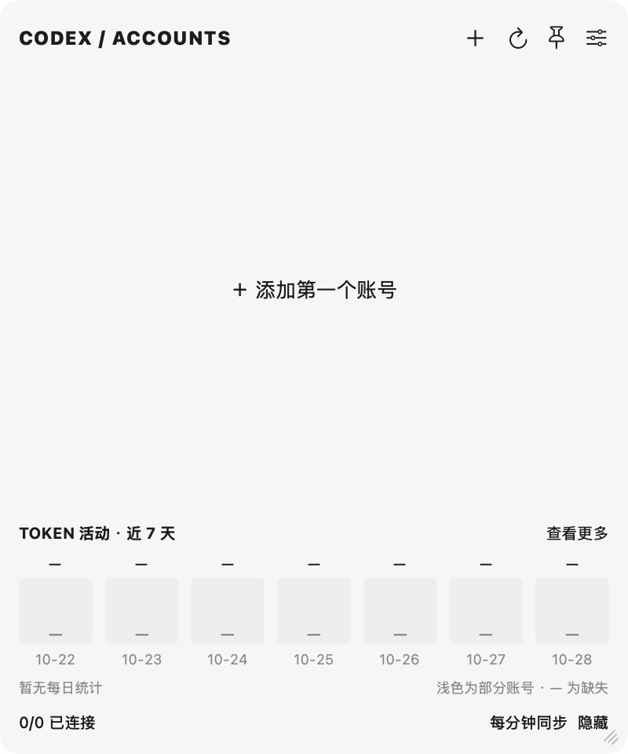
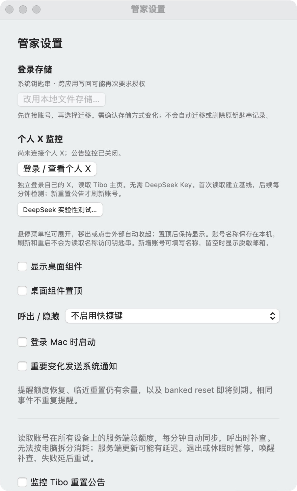

# v0.2.0-beta.1 验证记录

受测应用代码：`cf0fb894ad52c2901ccc54f5d6cf68e85d40f81c`。Apple Silicon / macOS，Swift 6。下载包不包含个人账号数据，仍为未公证的 ad-hoc 签名测试版。

| 检查 | 结果 | 范围 |
| --- | --- | --- |
| Swift 自动测试 | 72 通过，1 跳过，0 失败 | 新增文件迁移权限、身份校验、原子写入、错误回退、外部进程阻塞及钥匙串暂停重试；跳过可选外部 fixture |
| Release 构建与签名 | 通过 | Apple Silicon，ad-hoc hardened runtime，未 Apple 公证 |
| 新公开包启动与设置 | 通过 | 空账号0/0；显示0.2.0与存储入口，未确认不迁移；默认监控、通知、开机启动、快捷键关闭 |
| 与私人版本共存/退出 | 通过 | 私人管家二进制、正在运行的Codex与私人管家PID、默认认证文件均保持不变 |
| 同源切换核心的实号验证 | 通过一次正向切换 | 本机私人构建已实测A→B，用户确认成功；5账号切后刷新，观察窗口内系统授权日志无弹窗或partition mismatch |
| 源码、历史及下载包检查 | 通过 | Gitleaks及定向隐私检查；包只含程序、Info.plist和签名 |

**证据边界：公开发行包本轮没有导入私人凭据重新做实号OAuth、迁移或切号；上述实号结果来自同源私人构建，不能等同于所有用户环境已验证。** 公开版独立数据/回退服务名、默认设置与UI已单独核验。反向切号曾因Codex未退出而被保护逻辑阻止，随后测试用户选择保留新账号，未继续返程测试。完整项目列表未逐项核对。

适配桌面版本限定为26.1021.31345、26.1023.50603；其他版本拒绝切换。X实网新公告、Intel、新Mac安装、全部套餐/CLI组合和Apple公证路径未在本轮验证。文件模式是显式取舍：文件不加密，同一系统用户的进程可能读取，详见隐私说明。

---

# v0.1.0-beta.1 验证记录

受测应用代码：`cb5f4d4`。平台：Apple Silicon / macOS，Swift 6工具链。个人账号与服务端数据未打包。未宣称完成外部用户人工验收。

| 检查 | 结果 | 范围 |
| --- | --- | --- |
| Swift自动测试 | 50通过，1跳过，0失败 | 可选公开接口fixture测试未提供外部文件；无真实凭据 |
| Release构建与签名校验 | 通过 | 当前Apple Silicon架构，ad-hoc签名，未公证 |
| 全新公开版首次启动 | 通过 | 空账号0/0，不导入其他客户端账号 |
| 添加入口 | 通过 | 专用Chrome选项、空名称；未提交真实登录 |
| 默认设置 | 通过 | 公告、通知、开机启动、全局快捷键均默认关闭 |
| 与已有构建共存/退出 | 通过 | 独立数据目录，另一应用进程和二进制哈希不变 |
| 源码与新Git历史密钥扫描 | 通过 | Gitleaks默认规则未发现秘密；另检查个人路径、昵称和内部资料 |
| 下载包内容 | 通过 | 仅可执行文件、Info.plist和代码签名；无账号数据、浏览器会话或凭据 |

## 实际界面

## 本次未验证

- 公开版未使用发布者私人凭据完成新增OAuth、X登录或实网新公告事件；不会将个人构建的登录态移入公开版充作验收。
- 新公告分类、历史去重、全部账号刷新队列有自动化用例；真实X网页结构或接口变化仍可能导致失败。
- 未验证Intel、新安装的独立Mac、所有套餐、所有Codex CLI版本，以及Apple公证安装路径。
- DeepSeek抓取X仍为实验入口，未承诺可用。

这些限制也是测试版发布边界。欢迎使用者提交脱敏反馈。
