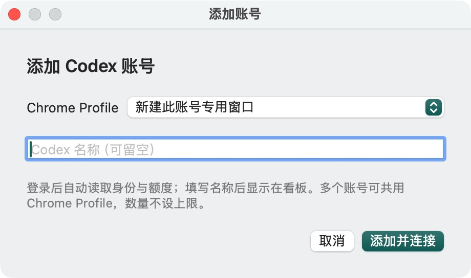
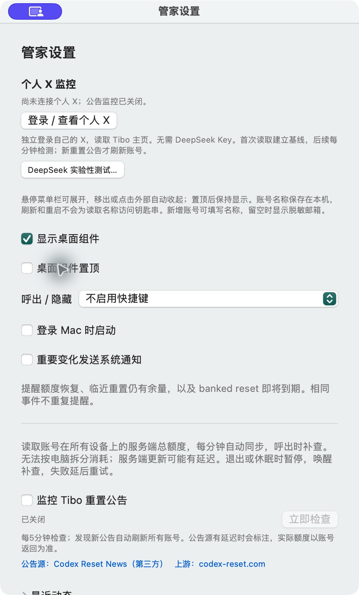

# v0.1.0-beta.1 验证记录

受测应用代码：`cb5f4d4`。平台：Apple Silicon / macOS，Swift 6工具链。个人账号与服务端数据未打包。未宣称完成外部用户人工验收。

| 检查 | 结果 | 范围 |
| --- | --- | --- |
| Swift自动测试 | 50通过，1跳过，0失败 | 可选公开接口fixture测试未提供外部文件；无真实凭据 |
| Release构建与签名校验 | 通过 | 当前Apple Silicon架构，ad-hoc签名，未公证 |
| 全新公开版首次启动 | 通过 | 空账号0/0，不导入其他客户端账号 |
| 添加入口 | 通过 | 专用Chrome选项、空名称；未提交真实登录 |
| 默认设置 | 通过 | 公告、通知、开机启动、全局快捷键均默认关闭 |
| 与已有构建共存/退出 | 通过 | 独立数据目录，另一应用进程和二进制哈希不变 |
| 源码与新Git历史密钥扫描 | 通过 | Gitleaks默认规则未发现秘密；另检查个人路径、昵称和内部资料 |
| 下载包内容 | 通过 | 仅可执行文件、Info.plist和代码签名；无账号数据、浏览器会话或凭据 |

## 实际界面

## 本次未验证

- 公开版未使用发布者私人凭据完成新增OAuth、X登录或实网新公告事件；不会将个人构建的登录态移入公开版充作验收。
- 新公告分类、历史去重、全部账号刷新队列有自动化用例；真实X网页结构或接口变化仍可能导致失败。
- 未验证Intel、新安装的独立Mac、所有套餐、所有Codex CLI版本，以及Apple公证安装路径。
- DeepSeek抓取X仍为实验入口，未承诺可用。

这些限制也是测试版发布边界。欢迎使用者提交脱敏反馈。
